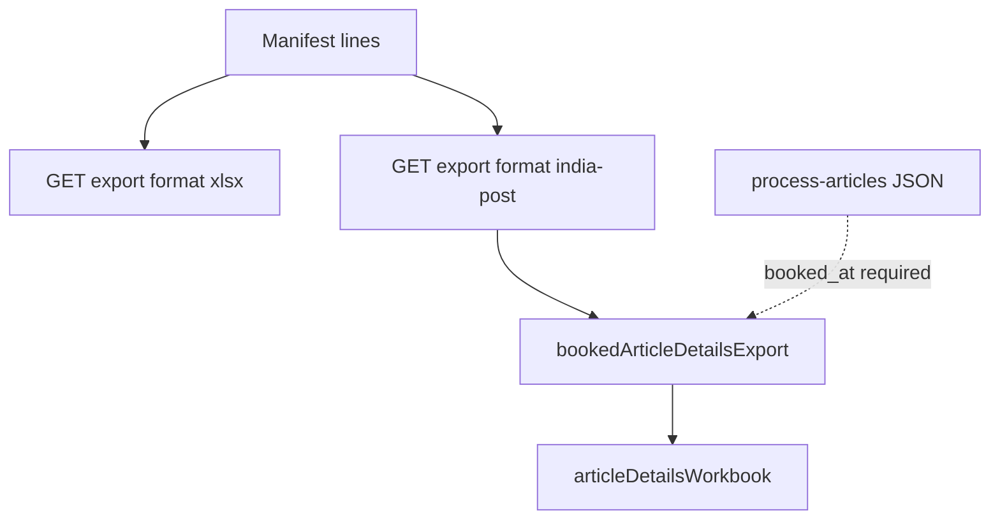

# Phase 1 — India Post Excel compatibility audit

Date: 2026-11-14  
Scope: documentation only. Application code, schema, bookings, and the handover manifest were not changed.  
Evidence: **VERIFIED** from source or the opened workbook. **INFERRED** where marked. **UNVERIFIED** where a live India Post import was not run.

This report follows the approved Phase 1 plan. It does not implement the later “India Post Excel” download.

---

## Reference files

| Requested | Result |
|---|---|
| `118_kltrends_2026-10-01_postbridge(3).xlsx` | **Not in the git repository.** The file that was opened is `D:\118_kltrends_2026-10-01_postbridge.xlsx` (no `(3)`). It has `ArticleDetails` (48 columns, 118 data rows) and `Information` (11 columns, 4 data rows). Treated as the PostBridge reference. Do not commit it (customer data). |
| `New_Customer_Integrations_approach_document_31052026 -new(8).docx` | **Missing.** Used `New_Customer_Integrations_approach_document_31052026 -new.docx` at the repo root. |
| Previous audit | `docs/audits/manifest-bulk-excel-booking-audit.md` |

The previous audit was right that the 118-row file was absent from the repo. It exists on `D:\`. The new check is a byte comparison of that file’s chrome against `modules/india-post/templates/article-details.template.xlsx`.

Paths from the earlier audit were re-checked and exist: `modules/manifests/service.ts`, `modules/manifests/export.ts`, `modules/booking-queue/export.ts`, `modules/india-post/article-details-sheet.ts`, `modules/india-post/bulk-excel-import.ts`, `modules/india-post/booking-run.ts`, `modules/india-post/booking-payload.ts`, `modules/india-post/provider.ts`, `lib/xlsx/`.

---

## Section 1 — Executive summary

PostBus can already emit a workbook that is **structurally compatible** with the opened PostBridge file: same sheet names and order, the same 48 ArticleDetails headers (including the trailing space in `LENGTH `), the same Information sheet, and the same styles, theme, and workbook XML.

**VERIFIED:** the bundled template is that workbook with the 118 data rows removed.

- ArticleDetails header-row XML is identical.
- The entire Information worksheet XML is identical.
- `xl/styles.xml`, `xl/workbook.xml`, and `xl/theme/theme1.xml` are identical.
- `articleDetailsWorkbook` in `modules/india-post/article-details-sheet.ts` clones the template and rewrites only `xl/worksheets/sheet1.xml` data rows.

A Shopify-booked PostBus shipment will **not** reproduce this merchant’s row conventions (PRIORITY always TRUE, sender line 3 equal to the city, every row COD). Those are properties of this sample, not of the generator’s structure.

The pickup handover file in `modules/manifests/export.ts` stays an 11-column `Manifest` sheet plus `Summary`. Booked ArticleDetails export already exists at `POST /api/v1/booking-queue/export` and does not call India Post. The manifest screen has no ArticleDetails action yet.

**India Post acceptance of a generated `.xlsx` is UNVERIFIED.** Booking in production is JSON (`/process-articles`) or a JSON file (`/process-articles-file`), not this workbook.

**This phase stops here.** Manifest export code is not added until a separate approval.

---

## Section 2 — Workbook structure comparison

Opened file: `D:\118_kltrends_2026-10-01_postbridge.xlsx`.

| Fact | Value | Class |
|---|---|---|
| Package | No `sharedStrings.xml`. Inline strings. Parts: Content_Types, rels, docProps, workbook, styles, theme, metadata, sheet1, sheet2 | VERIFIED |
| Sheets, order | `ArticleDetails`, then `Information` | MATCH |
| ArticleDetails dimension | `A1:AV119` (header + 118) | VERIFIED |
| Information dimension | `A1:K5` (header + 4) | VERIFIED |
| Formulas | None in either sheet | MATCH |
| Data validation | None | MATCH |
| Hidden columns/rows | None (`hidden="1"` absent) | MATCH |
| Core properties | Empty `cp:coreProperties` | MATCH with template |
| Number style `s="1"` | `cellXfs` index 1, `numFmtId="1"` (integer) | MATCH; used for weight and COD amount |

| Item | Original | Bundled template | Generator | Class |
|---|---|---|---|---|
| Sheet names and order | ArticleDetails, Information | Same | Untouched `workbook.xml` | MATCH |
| 48 headers, including `LENGTH ` | Cell V1 value `LENGTH ` | Header XML identical | Header row kept from the template | MATCH |
| Information headers, including `INSTRICTION RTS` | Exact list below | Sheet XML identical | Cloned unchanged | MATCH |
| Information lookup values | 4 data rows (table in Section 4) | Same | Same | MATCH |
| REG, OTP, ACK | Excel boolean `t="b"`, all 118 are `0` | No data rows | `bool` writes `t="b"` `0` or `1` | MATCH (type) |
| PRIORITY FLAG | Excel boolean, all 118 are `1` | No data rows | Booked export writes boolean FALSE | VALUE DIFFERENCE |
| PHYSICAL WEIGHT | Number, `s="1"`, all `100` | Style present | `styledNumber` | MATCH (type) |
| LENGTH, BREADTH/DIAMETER, HEIGHT | Unstyled numbers `20`, `15`, `2` on every row | No data rows | Unstyled `number` | MATCH (type) |
| VALUE FOR CODR/COD | Number, `s="1"` | Style present | `styledNumber` | MATCH (type) |
| PIN, mobile, barcode | `t="str"` | — | `text` | MATCH |
| Empty optionals | Present empty cells `<v></v>` with `t="str"` | — | `null` text becomes an empty string cell | MATCH |
| ALT ADDRESS FLAG | Empty text on all 118, not a boolean | — | Kind is `text`; unused writes empty | MATCH for this sample |
| SENDER STATE/UT | `KERALA ` with trailing space (`xml:space="preserve"`) on all 118 | — | `cell()` trims | FORMAT DIFFERENCE |
| SENDER ADD LINE 3 | `TIRUR` on all 118, equal to sender city | — | Blank | VALUE DIFFERENCE |
| CODR/COD | `cod` on all 118. No prepaid rows. No `codr` in data | Information lists `codr` and `cod` | Lowercase `cod` / `codr` when COD | MATCH vs this file; JSON uses `COD` |
| Filename | `…_postbridge.xlsx` | — | `{count}_{store}_{date}_postbus.xlsx` | VALUE DIFFERENCE (name only) |

`templateCellXml` in `lib/xlsx/template-clone.ts` (lines 31–32) always writes a boolean cell: true → `1`, anything else → `0`. The original does the same for REG, OTP, ACK, and PRIORITY (it never omits those cells).

Column 22 header, original cell V1: `LENGTH ` (trailing space). **VERIFIED MATCH** with `ARTICLE_DETAILS_HEADERS` in `modules/india-post/article-details-sheet.ts` (the `"LENGTH "` entry) and with the template header XML.

---

## Section 3 — Complete 48-column mapping

Path for a booked export: `bookedShipmentRow` in `modules/booking-queue/export.ts` (lines 69–108) → `mapShipmentToArticle` in `modules/india-post/article-mapper.ts` (lines 46–142) → `articleDetailsRow` in `modules/india-post/article-details-sheet.ts` (lines 101–153).

“Survives booking” means the value is on `shipments` or a related row after `booked_at` is set. “Survives import/export” means an uploaded ArticleDetails value is still available when that shipment is booked or exported again.

Reference types are from the 118 data rows.

| # | Excel Column | Database Source | Current Mapping | Reference Type | PostBus Type | Status | Required Fix |
|---|---|---|---|---|---|---|---|
| 1 | SERIAL NUMBER | none | Renumbered 1..n per file (`renumberArticleDetailsRows`) | number, 1–118 unique | number | MATCH | None |
| 2 | BARCODE NO | `shipments.tracking_number`, else `barcode` | Uppercase text | text, 118 unique `EY…IN` | text | MATCH if booked | Refuse a row with no barcode. Export today filters on `booked_at` only |
| 3 | PHYSICAL WEIGHT | `shipments.weight_grams` | `toIndiaPostPhysicalWeightGrams` (`Math.round`); blank cell if ≤ 0 (`dimension`) | styled number; all 100 | styled number | MATCH type | Export the stored grams. Do not recompute from products. Sample’s constant 100 is that file, not a rule |
| 4 | REG | not a shipment column | `Boolean(article.reg)`; mapper sets `reg: false` | boolean FALSE (118/118) | boolean FALSE | MATCH vs this file; import value is lost | Persist only if Excel import must round-trip |
| 5 | OTP | not stored; `indiaPostRequiresOtp(serviceCode)` | TRUE only for `24_SPP_PARSPL` | boolean FALSE (118/118) | boolean | MATCH for non-NDD | Do not copy sheet OTP onto Shopify bookings |
| 6 | RECEIVER CITY | `addresses.city` | trim | text, 98 distinct | text | MATCH | None |
| 7 | RECEIVER PINCODE | `addresses.pincode` | text cell | text, 113 distinct | text | MATCH | Validate 6 digits on export; do not coerce to a number |
| 8 | RECEIVER NAME | `addresses.name` | trim | text | text | MATCH | None |
| 9 | RECEIVER ADD LINE 1 | `addresses.line1` | `wrapIndiaPostAddressLines` | text | text | PARTIAL | Do not duplicate line 1 into line 2 the way this sample often does |
| 10 | RECEIVER ADD LINE 2 | `addresses.line2` | same wrap | text | text | PARTIAL | Same |
| 11 | RECEIVER ADD LINE 3 | `addresses.line3` | same wrap | text; this sample often repeats the state | text | PARTIAL | Keep state in RECEIVER STATE/UT. Do not copy state into line 3 to imitate the sample |
| 12 | ACK | not a shipment column | mapper `ack: false` | boolean FALSE (118/118) | boolean FALSE | MATCH vs this file; import lost | Persist only if import must round-trip |
| 13 | SENDER MOBILE NO | `organizations.phone`, else pickup `phone` | `indiaPostMobile` | text | text | PARTIAL | Booking and export share `organizationLabelSender`, not the sheet’s sender |
| 14 | RECEIVER MOBILE NO | `addresses.phone` | `indiaPostMobile`, else raw text in `party()` | text | text | MATCH type | Validate before export |
| 15 | PREPAYMENT CODE | not stored | empty string | empty text (118/118) | empty text | MATCH vs this file; import lost | Persist only for Excel-origin articles |
| 16 | VALUE OF PREPAYMENT | not stored | blank unless &gt; 0 (`amount`) | empty text (118/118) | empty text | MATCH vs this file | Same |
| 17 | CODR/COD | `shipments.payment_mode`, `cod_amount` | `cod` if COD and amount &gt; 0, else `""`. `codr` only if `codKind === "CODR"`. Shipment mapping sets kind `COD`, so re-export never writes `codr` | text `cod` (118/118) | text `cod` | MATCH vs this file. JSON sends `COD` | Keep Excel lowercase. Do not change the JSON payload |
| 18 | VALUE FOR CODR/COD | `shipments.cod_amount` | styled number, or null (empty) when not COD | styled number, 16 distinct amounts | styled number | MATCH type | Prepaid must stay empty. This file has no prepaid rows |
| 19 | INSURANCE TYPE | not stored | empty | empty text (118/118) | empty text | MATCH vs this file; import lost | Persist only if import must round-trip |
| 20 | VALUE OF INSURANCE | not stored | blank unless &gt; 0 | empty text (118/118) | empty text | MATCH vs this file | Same |
| 21 | SHAPE OF ARTICLE | derived | `indiaPostShapeOfArticle`: `NROL` for parcel products, `DOC` for document products | text `NROL` | text | MATCH for parcels | Do not invent `ROLL` |
| 22 | LENGTH  | `shipments.length_cm` | number if &gt; 0, else empty. Header space is in the template, not in the value | unstyled number; all 20 | unstyled number | MATCH type | Do not trim the header. Do not fill a missing length |
| 23 | BREADTH/DIAMETER | `shipments.width_cm` | same | unstyled number; all 15 | unstyled number | MATCH type | Same |
| 24 | HEIGHT | `shipments.height_cm` | same | unstyled number; all 2 | unstyled number | MATCH type | Same. Export does not read `shipment_packages` or variant dimensions |
| 25 | PRIORITY FLAG | **no shipment column** | `priorityFlag` unset → Excel FALSE (`article-details-sheet.ts` line 128) | boolean TRUE (118/118) | boolean FALSE | VALUE DIFFERENCE | Do not change FALSE to TRUE. See Section 7 |
| 26 | DELIVERY INSTRUCTION | not stored | empty | empty text (118/118) | empty text | MATCH vs this file; import lost | Persist only if import must round-trip |
| 27 | DELIVERY SLOT | not stored | empty | empty text (118/118) | empty text | MATCH vs this file | Same |
| 28 | INSTRUCTION RTS | not stored | empty | empty text (118/118) | empty text | MATCH vs this file | Same |
| 29 | SENDER NAME | organizations, else pickup contact, else shop name | `organizationLabelSender` | text, constant on all 118 | text | PARTIAL | Same source as booking. Not the Excel sender |
| 30 | SENDER COMPANY NAME | `organizations.name`, else pickup name | `exportContext.senderCompany` | text, same as sender name in this file | text | PARTIAL | None for Shopify path |
| 31 | SENDER CITY | org, else pickup `city` | trim | text `TIRUR` on all 118 | text | PARTIAL | None |
| 32 | SENDER STATE/UT | org, else pickup `state` | trim | text `KERALA ` with trailing space | trimmed text | FORMAT DIFFERENCE | Do not add a trailing space to imitate the file |
| 33 | SENDER PINCODE | export: org/pickup `pincode`. Booking: resolved origin office PIN | text | text `676102` | text | RISK | Export the PIN that was booked, not a later profile edit |
| 34 | SENDER EMAILID | not selected | blank | empty (118/118) | empty | MATCH vs this file | Optional |
| 35 | SENDER ALT CONTACT | not passed into `mapShipmentToArticle` | blank | text, one number on all 118 | blank | MISSING | Map a stored secondary phone only if one exists. Do not invent it |
| 36 | SENDER KYC | not stored | blank | empty (118/118) | empty | MATCH vs this file; import lost | Persist only if import must round-trip |
| 37 | SENDER TAX | not stored | blank | empty (118/118) | empty | MATCH vs this file | Same |
| 38 | RECEIVER COMPANY NAME | `addresses.company_name` | blank when it equals the person name (`article-details-sheet.ts` line 141) | empty (118/118) | text or empty | MATCH vs this file | None |
| 39 | RECEIVER STATE/UT | `addresses.state` | trim | text | text | MATCH | None |
| 40 | RECEIVER EMAILID | `addresses.email` | trim | empty in this file’s first row pattern; not re-counted as a required field | text | MATCH when empty | None |
| 41 | RECEIVER ALT CONTACT | not stored on the export select | blank | empty (118/118) | empty | MATCH vs this file | Persist only if import must round-trip |
| 42 | RECEIVER KYC | not stored | blank | empty | empty | MATCH vs this file | Same |
| 43 | RECEIVER TAX REF | not stored | blank | empty | empty | MATCH vs this file | Same |
| 44 | ALT ADDRESS FLAG | not stored | `true` or `null`. Kind is `text`, not `bool` | empty text (118/118) | empty text | MATCH when unused | If ever true, the cell is the string `true`, not an Excel boolean. Confirm before changing the kind |
| 45 | BULK REFERENCE | `orders.order_number` | trim. API slices to 50; this export does not | text (order-style refs such as `#7815`) | text | MATCH intent | Slice to 50 so the sheet matches the API |
| 46 | SENDER ADD LINE 1 | org `line1`, else pickup `line1` | skips the literal `Registered pickup` | text, constant street line | text | PARTIAL | Booking uses the same helper |
| 47 | SENDER ADD LINE 2 | org `line2`, else pickup `line2` | same | text, constant second street line | text | PARTIAL | Organization identity has `line1` and `line2` only (`supabase/migrations/20260921214500_organization_label_identity.sql`) |
| 48 | SENDER ADD LINE 3 | **no column** on organizations or pickup_locations | not passed (`booking-run.ts` sender fields stop at `senderLine2`) | text `TIRUR`, equal to sender city on all 118 | blank | MISSING | Do not copy the city into line 3. Add a real third street line only when one is stored |

Null handling in the generator (`article-details-sheet.ts` lines 88–98, 205–254):

- Text: trim to `""`, written as `t="str"`.
- Weight, dimensions, COD amount: `null` when not a positive finite number. `templateCellXml` writes an empty text cell for a non-finite number.
- REG, OTP, ACK, PRIORITY: always a real boolean, including FALSE.
- ALT ADDRESS FLAG: `null` when off, which becomes an empty text cell. TRUE would be the string `true` because the column kind is `text`.

---

## Section 4 — Information sheet compatibility

**VERIFIED:** `xl/worksheets/sheet2.xml` in the opened workbook equals the same part in the bundled template.

Headers, exact spelling:

1. SHAPE OF ARTICLE
2. BOOLEAN
3. DELIVERY INSTRUCTION
4. DELIVERY INSTRUCTION DESCRIPTION
5. DELIVERY SLOT format
6. INSTRICTION RTS
7. INSTRICTION RTS DESCRIPTION
8. CODR/COD
9. INSURANCE
10. PREPAYMENT
11. PREPAYMENT DESCRIPTION

Data rows:

| Row | Shape | Boolean | Instruction | Description | Slot | RTS | RTS description | COD | Insurance | Prepay | Prepay description |
|---|---|---|---|---|---|---|---|---|---|---|---|
| 2 | ROLL | Excel true (`t="b"` `1`) | ND | NORMAL DELIVERY | 02:00-04:00 | RTS | RETURN TO SENDER ADDRESS | codr | DOP | SS | SERVICE STAMPS |
| 3 | NROL | Excel false (`0`) | OD | OPEN DELIVERY | 02:00-04:00 | RTA | RETURN TO ALTERNATE ADDRESS | cod | | FM | FRANKING MACHINE |
| 4 | DOC | | SD | SCHEDULED DELIVERY | | | | | | PS | POSTAGE STAMPS |
| 5 | | | SPDS | SMART PARCEL DELIVERY SYSTEM | | | | | | | |

PostBus does not read this sheet for validation. `article-details-template.test.ts` requires every zip part except `sheet1.xml` to stay byte-identical to the template, so generated files keep these rows.

The approach document’s field table does not match this sheet:

- Prepayment: sheet `SS`, `FM`, `PS`. API and `article-validator.ts` allow `QR` or `SQ`.
- Delivery slot: sheet `02:00-04:00`. API allows `9am-2pm`, `2pm-5pm`, `5pm-8pm`.
- Delivery instruction: sheet includes `SPDS`. Validator allows only `ND`, `OD`, `SD`.

Which list an Excel importer uses is **UNVERIFIED**. JSON booking follows the field table.

---

## Section 5 — Confirmed mapping problems

1. **PRIORITY FLAG.** Sample is TRUE on every row. Booked export writes FALSE. `mapShipmentToArticle` never sets `priorityFlag`. JSON `priority_flag` is `""` when unset (`booking-payload.ts` line 59). Domestic label payload sets `priority: false` (`endpoints.ts` around line 410).
2. **Sender line 3.** Organizations and pickup locations have no `line3`. Booking (`booking-run.ts` around 707–711 and 835–838) and export omit it. The sample puts the city in line 3.
3. **Sender PIN.** Export uses organization or pickup PIN (`booking-queue/export.ts` `exportContext`). Booking uses the resolved origin office PIN (`booking-run.ts` around line 831, `senderPin: origin.pincode`).
4. **Sender alt contact.** Present and constant in the sample. Not selected for export.
5. **Optional Excel fields dropped after import.** `materializeRow` in `bulk-excel-import.ts` (shipment insert around lines 868–896) stores barcode, weight, dimensions, COD, and address. It does not store REG, ACK, priority, insurance, prepayment, delivery fields, KYC, tax, or alt address. Booking then calls `mapShipmentToArticle`, which hard-codes `ack: false`, `reg: false`, empty insurance.
6. **COD token.** Excel writer (`article-details-sheet.ts` line 120) emits `cod` or `codr`. JSON (`booking-payload.ts` line 94) emits `COD` or `CODR` or `""`. The sample and the Information sheet use lowercase.
7. **Address length.** `wrapIndiaPostAddressLines` can leave the last line longer than 80 characters. JSON `streetFields` then slices each line to 80 (`booking-payload.ts` lines 32–38). Excel writes the wrapped string with no slice.
8. **Manifest download is not ArticleDetails.** `MANIFEST_EXPORT_HEADERS` in `modules/manifests/export.ts` lines 4–16. UI link `exportHref("xlsx")` in `app/(site)/dashboard/manifests/[id]/page.tsx` line 187 and 211.
9. **Booked export does not call `validateIndiaPostArticle`.** Invalid PIN or phone can still be written.
10. **Barcode.** A shipment with `booked_at` and both barcode fields empty would export a blank barcode. Uniqueness of non-null barcodes is per organization (`shipments_org_barcode_uidx`).

---

## Section 6 — Data-loss assessment

For each field: accepted on Excel import, validated, stored on the shipment, sent on JSON booking, available on re-export, recoverable after materialize.

| Field | Import | Validated | Stored | Used in JSON booking | Re-export | Recoverable |
|---|---|---|---|---|---|---|
| REG | Yes | Flag parse | No | Always `"FALSE"` | Always FALSE | No |
| ACK | Yes | Flag parse | No | Always `"FALSE"` | Always FALSE | No |
| PRIORITY FLAG | Yes | Flag parse | No | `""` unless the in-memory draft set it (shipment path does not) | FALSE | No |
| INSURANCE TYPE | Yes | `DOP` or empty | No | `""` | blank | No |
| VALUE OF INSURANCE | Yes | required if DOP | No | `0` | blank | No |
| PREPAYMENT CODE | Yes | `QR` or `SQ` | No | `""` | blank | No |
| VALUE OF PREPAYMENT | Yes | with code | No | `0` | blank | No |
| DELIVERY INSTRUCTION | Yes | ND, OD, SD | No | `""` | blank | No |
| DELIVERY SLOT | Yes | documented slots | No | `""` | blank | No |
| INSTRUCTION RTS | Yes | RTS or RTA | No | `""` | blank | No |
| SENDER KYC | Yes | length when present | No | `""` | blank | No |
| SENDER TAX | Yes | length when present | No | `""` | blank | No |
| RECEIVER KYC | Yes | length when present | No | `""` | blank | No |
| RECEIVER TAX REF | Yes | length when present | No | `""` | blank | No |
| ALT ADDRESS FLAG | Yes | requires alt party when true | No | `"FALSE"` | empty cell | No |
| OTP | Yes | NDD forces TRUE at map time | No | TRUE only for `24_SPP_PARSPL` | same | Sheet OTP for other services is lost |
| Barcode, weight, dimensions, COD, receiver address, bulk reference | Yes | Yes | Yes (reference becomes `orders.order_number`) | Yes, rebuilt from those columns | Yes | Yes |

### Snapshot options (not implemented)

**Option A — columns on `shipments`.** Straightforward reads. Mixes Excel-only flags into every Shopify shipment. More migration surface.

**Option B — one validated article snapshot (jsonb) on the shipment or the booking attempt.** Matches `DraftArticle`. Import and a future booking path can share it. **Recommended if** Excel-origin flags must survive. Not required for a Shopify manifest download of barcode, weight, COD, and address.

**Option C — reuse the serialized booking payload.** `serializeIndiaPostBookingArticle` is only in memory. `persistOrFlagBooked` (`booking-run.ts` lines 124–149) writes weight, dimensions, and `booking_office_id` when defaults were missing. It does not store the payload. **Not available** as history.

A manifest Excel of already booked Shopify shipments does not need Option B to explain PRIORITY or REG: those values were never on the shipment. The sample’s TRUE priority is a PostBridge convention, not stored PostBus data.

---

## Section 7 — COD and priority

### COD

**VERIFIED**

- Excel: COD only when `paymentMode === "COD"` and `codAmount > 0`. Token is lowercase `cod`, or `codr` if `codKind === "CODR"`. Amount is `shipments.cod_amount`. Prepaid: COD columns empty, not zero (`article-details-sheet.ts` lines 102, 120–121).
- JSON: `codr_cod` is `COD` or `CODR` or `""`. Amount is the number, or `""` when not COD (`booking-payload.ts` lines 94–95). `mapShipmentToArticle` sets `codKind` to `COD` for every COD shipment (line 134), so CODR from a sheet is dropped before booking.
- Partial payment: `shipmentCollectFromOrder` in `modules/orders/payment.ts` uses the stored remainder for `COD` and `PARTIAL`. The export does not re-read Shopify `total_outstanding`.
- Decimals: COD amount is a JS number written as a styled Excel number. The sample amounts are whole rupees.
- Sample: 118/118 `cod`. No prepaid row. `codr` appears only on the Information sheet.

**Do not change the production JSON spelling in a later Excel task.** Whether India Post’s Excel importer wants `cod`, `COD`, or `CODR` is **UNVERIFIED** and needs confirmation. Until then, Excel stays lowercase, which matches this file and the Information sheet.

### Priority

**VERIFIED**

- Why the exporter writes FALSE: `articleDetailsRow` treats priority as TRUE only when `priorityFlag` is the string `"TRUE"`. The shipment mapper leaves it unset, so the comparison is false (`article-details-sheet.ts` line 128).
- Shipments do not store priority.
- The API receives `priority_flag: ""` on the normal booking path, not the boolean TRUE.
- No branch in `booking-run.ts` sets priority from article type or contract.
- No merchant setting was found for article priority (support-ticket “priority” is unrelated).

The sample’s universal TRUE is **INFERRED** to be a PostBridge default for that export, not an India Post rule proven by this audit.

**Business rule for a later implementation:** do not set PRIORITY FLAG to TRUE to match this file. Leave it FALSE (current generator) unless a stored value exists. A workspace default would be a separate product decision, not a silent change.

---

## Section 8 — Booking safety

`bookedArticleDetailsExport` (`modules/booking-queue/export.ts` lines 111–226):

- Selects `shipments` with `.eq("organization_id", ctx.organizationId)` and `.not("booked_at", "is", null)`.
- Dedupes requested ids.
- Caps at 5,000 (`BOOKED_EXPORT_MAX`).
- Does not import `provider`, `allocate-barcode`, or `booking-run`.
- Does not update `booked_at`, status, or manifest status.
- Does not allocate a barcode.

`articleDetailsWorkbook` only fills the template.

`GET /api/v1/manifests/:id/export` (`lib/api/v1/manifests.ts` lines 89–116) builds CSV, PDF, or handover xlsx from `getManifest`. It does not book. `loadManifestRow` filters `organization_id` (`modules/manifests/service.ts` lines 446–456).

A future adapter that passes manifest shipment ids into `bookedArticleDetailsExport` stays read-only **if** it does not call `confirmImportBatch`, `runIndiaPostBooking`, or `allocateNextBarcode`. Those functions are the ones that create shipments, POST to India Post, or issue AWBs.

| Situation | Current behavior |
|---|---|
| No barcode | Manifest RPC will not add the shipment. Booked export can still emit a blank barcode if `booked_at` is set. |
| Invalid barcode | Booking validator rejects before POST. Export does not re-validate. |
| Two shipments, one barcode | Unique index per organization where barcode is not null. |
| Rejected booking | No `booked_at` → excluded from ArticleDetails export. |
| Unresolved booking | Recovery state is not `booked_at`; excluded. |
| Cancelled after booking | Stays on the manifest. Export includes it if `booked_at` is set. |
| Already on a manifest | Unique `manifest_shipments.shipment_id`. Export does not add another manifest. |

Duplicate booking from a download: **not present** on handover export or booked ArticleDetails export.

---

## Section 9 — Recommended architecture

Smallest later change, not done in this phase:

```text
Manifest detail
  → existing GET handover (format=xlsx) unchanged
  → new GET format=india-post (or a sibling path)
       → manifest line shipment ids for this organization
       → bookedArticleDetailsExport (already requires booked_at)
       → articleDetailsWorkbook
       → download
```

Do not replace `manifestXlsx`. Do not send the xlsx to `process-articles-file`. Do not change `booking-run.ts` for the download.

Optional later, each its own approval:

- Run `validateIndiaPostArticle` and skip rows with no barcode.
- Prefer the booked origin PIN.
- Persist an article snapshot (Option B) only for Excel-import flags.
- Add sender `line3` only when a third street line is a real stored field. Do not copy city into line 3.



---

## Section 10 — Implementation plan

**Done in this phase:** this document only.

**Not started. Requires a separate approval.**

| Area | Change |
|---|---|
| `modules/manifests/schema.ts` | Add export format `india-post`. Keep `xlsx`, `csv`, `pdf`. |
| `lib/api/v1/manifests.ts` | On that format, load the manifest (org-scoped), pass shipment ids to `bookedArticleDetailsExport`, return the workbook. 400 when none are booked or a barcode is missing. No writes. |
| `app/(site)/dashboard/manifests/[id]/page.tsx` and `app/(site)/dashboard/manifests/page.tsx` | Label the current file **Handover list**. Add **India Post Excel**. |
| Tests | Compare generated sheet names, header XML including `LENGTH `, and Information bytes to the **template**, not to the customer workbook. Fixtures: COD, prepaid, long address, missing optionals, existing barcode. Assert the export module does not import the booking provider. |
| Database | None for the download. Snapshot or `line3` only if a later decision requires them. |
| Rollback | Remove the new format and the new link. `format=xlsx` stays the handover file. |

Risks: merchants uploading the handover file to India Post; PRIORITY FALSE versus this PostBridge sample; synchronous generation up to 5,000 rows; sender PIN differing from the booked origin.

Permission: GET stays `manifests.read` (`lib/api/v1-permissions.ts` lines 111–112).

---

## Section 11 — Acceptance criteria

For the future download, not for this document:

- Handover `format=xlsx` remains the 11-column Manifest sheet plus Summary.
- India Post file has sheets `ArticleDetails` and `Information`, 48 headers in order, header text `LENGTH ` with the trailing space, Information sheet equal to the template.
- Rows are only that organization’s manifest shipments with `booked_at` and a barcode.
- The handler does not call India Post, does not allocate a barcode, and does not change `booked_at`, shipment status, or manifest status.
- COD rows use `cod` and `shipments.cod_amount`. Prepaid COD cells are empty.
- PRIORITY stays FALSE unless a stored flag exists.
- Sender line 3 stays blank unless a stored third street line exists.
- REG, OTP, and ACK are Excel booleans. Unused ALT ADDRESS FLAG is an empty text cell.
- PIN, mobile, and barcode are `t="str"`.
- Tests do not book with India Post and do not commit rows from the 118-row customer file.

---

## Unresolved India Post questions

1. Excel import token: `cod`, `COD`, or `CODR`.
2. Whether PRIORITY FLAG must be TRUE, may be FALSE, or is ignored.
3. ALT ADDRESS FLAG: empty text, boolean FALSE, or boolean TRUE.
4. Whether sender line 3 must repeat the city.
5. Prepayment codes on the Information sheet (`SS`, `FM`, `PS`) versus the API (`QR`, `SQ`).
6. Whether India Post accepts this xlsx at all. The booking API documented in the approach file is JSON and a JSON file. **Acceptance is not claimed.**

---

## Hold

Application behavior is unchanged. The manifest “India Post Excel” action is **not implemented**. Start that work only after an explicit approval that is separate from this audit.
